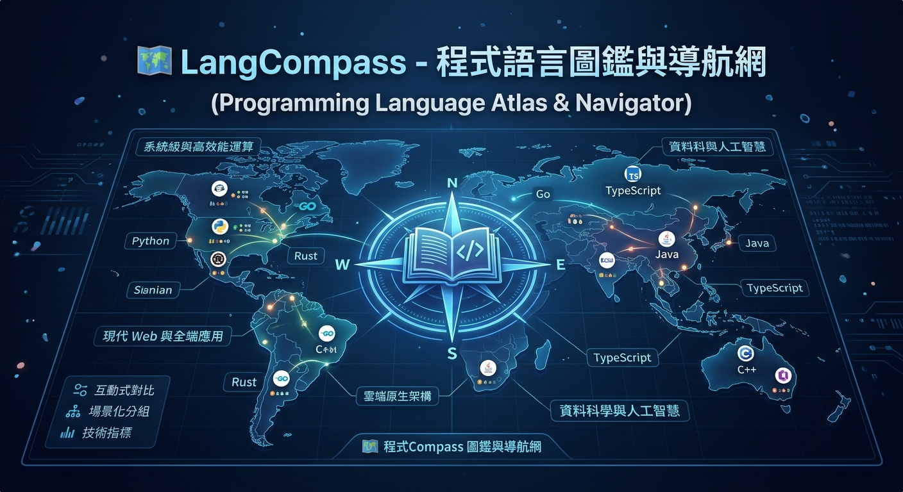

# 🗺️ LangCompass - 程式語言圖鑑與導航網 (Programing Language Atlas & Navigator)

[]()
[](LICENSE)
[]()

一個專為開發者與技術愛好者打造的現代化程式語言與技術生態導航平台。透過結構化分類、多維度對比與場景化圖鑑，幫助開發者迅速探索、評估並掌握各主流與前沿程式語言及其生態系。


---

## 🌟 核心特色 (Core Features)

- **全景式語言圖鑑 (Language Atlas)**：收錄主流與次世代程式語言的深度檔案，包含語法特性、生態優勢、適用場景與效能定位。
- **場景化導航 (Use Case Grouping)**：打破傳統依字母排序的限制，根據實際開發需求（如：高併發後端、系統程式設計、前端互動、資料科學、雲端原生架構）精準分組導航。
- **互動式生態對比**：提供多維度技術指標對比，協助技術選型與架構評估。
- **極速與現代化體驗**：採用高效能前端技術棧建構，確保極速載入與流暢的瀏覽體驗。
- **聞名的框架、庫和工具**：介紹關於此程式語言的優秀框架、庫和工具。

---

## 🧭 導航與分類架構 (Taxonomy & Grouping)

本站將程式語言與技術生態劃分為以下核心板塊，方便快速檢索：

1. **系統級與高效能運算 (Systems & High-Performance)**
   - *代表語言*：Rust, C++, C, Goose, Nim, Zig, Odin, Carbon, D, V
   - *適用場景*：底層基礎設施、分散式系統、微服務核心、嵌入式開發。
2. **現代 Web 與全端應用 (Modern Web & Full-Stack)**
   - *代表語言*：TypeScript, JavaScript, Dart, PHP, Perl, CoffeeScript
   - *適用場景*：高效能 Web 應用、跨平台前端、動態服務端渲染。
3. **後端應用**：
   - *代表語言*：Java, C#, G#, Go
   - *適用場景*：
4. **資料科學與人工智慧 (Data Science & AI)**
   - *代表語言*：Python, Julia, R, MATLAB, Mojo
   - *適用場景*：機器學習模型訓練、大數據管線、科學計算、自動化腳本。
5. **雲端原生與分散式基礎設施 (Cloud-Native & Distributed)**
   - *代表語言*：Go, Rust, Shell/Bash
   - *適用場景*：容器化工具、網格運算、自動化运维與命令列工具。
6. **晶片設計（Chip Design）**
   - *代表語言*：Veryl, Spade

---

## 🛠️ 技術選型 (Tech Stack)

- **應用框架**：[Grit Framework](https://gritframework.dev/)（Go + Gin/GORM API）
- **前端**：React、TypeScript、Vite 與 TanStack Router
- **樣式與排版**：Tailwind CSS v4
- **資料庫**：本機開發預設使用 SQLite；可依 Grit 設定切換其他資料庫

---

## 🚀 快速開始與本地開發

如果你想在本地端執行或參與本專案的內容維護，請依循以下步驟：

### 1. 環境需求
- Node.js (>= 22.x)、Go (>= 1.24)、pnpm

### 2. 安裝相依套件
```bash
# 進入 Grit 專案
cd src/web-frontend

# 安裝前端相依套件
pnpm install

```

### 3. 啟動開發伺服器

```bash
# 僅啟動前端
pnpm dev

# 啟動 Grit API 與前端
grit start

```

前端預設位於 `http://localhost:5173`。Grit 專案與 SQLite 資料庫已包含在 `src/web-frontend`，本機開發不需要啟動 Docker。

---

## 🤝 參與貢獻 (Contributing)

我們非常歡迎社群開發者一同豐富這座「程式語言圖鑑」！無論是修正錯字、補充語言特性、優化分類場景，或是提交新語言收錄，都非常感謝：

1. Fork 本倉庫
2. 建立你的特性分支 (`git checkout -b feature/AddRustEcosystem`)
3. 提交你的改動 (`git commit -m 'Add detailed ecosystem breakdown for Rust'`)
4. 推送到分支 (`git push origin feature/AddRustEcosystem`)
5. 開啟一個 Pull Request

---

## 📄 授權條款

本專案採用 [MIT License](https://www.google.com/search?q=LICENSE) 開源授權。
